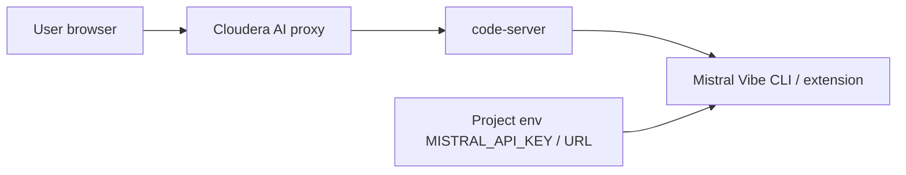

# Cloudera Blueprint: VS Code + Mistral Vibe on Cloudera AI

Custom ML runtime for **Cloudera AI Workbench / CML** that launches **VS Code in the browser** via [code-server](https://github.com/coder/code-server), with the **[Mistral Vibe CLI](https://docs.mistral.ai/vibe/code/cli/install-setup)** and **[Mistral Vibe VS Code extension](https://marketplace.visualstudio.com/items?itemName=mistralai.mistral-vibe-code)** preinstalled.


## Table of Contents

- [Overview](#overview)
- [Key Features](#key-features)
- [Quickstart](#quickstart)
- [Mistral Vibe credentials (project environment)](#mistral-vibe-credentials-project-environment)
- [Using Vibe in the session](#using-vibe-in-the-session)
- [Architecture](#architecture)
- [Repository Structure](#repository-structure)
- [Prerequisites](#prerequisites)
- [Documentation](#documentation)

## Overview

This blueprint gives teams a governed Cloudera AI session with a full IDE and Mistral’s agentic coding tools. VS Code runs in the workbench proxy; Vibe is available both as a **CLI in the integrated terminal** and as the **Mistral Vibe panel** inside the editor.

**Primary outcome:** Edit project code in VS Code and use Mistral Vibe without installing tools on a laptop or storing API keys in the runtime image.

## Key Features

- **In-browser VS Code** via code-server (`ML_RUNTIME_EDITOR=VsCode`)
- **Python 3.13 PBJ Workbench** base image
- **Mistral Vibe CLI** installed with the official [install script](https://mistral.ai/vibe/install.sh) (`uv` + `mistral-vibe`)
- **Mistral Vibe VS Code extension** (`mistralai.mistral-vibe-code`) preinstalled from Open VSX (same extension ID as the [Visual Studio Marketplace](https://marketplace.visualstudio.com/items?itemName=mistralai.mistral-vibe-code))
- **Project-scoped credentials:** `MISTRAL_API_KEY` and optional `MISTRAL_API_URL` from **Cloudera AI project environment variables** (no secrets baked into the image)

## Quickstart

1. **Register the runtime** in **Admin → Runtime Catalog → Add Runtime**.

   **Fast path** — use the published image (no local build):

   ```text
   docker.io/kevintalbert/vscvibe:1.0.0
   ```

   **Custom build** — when you need a different PBJ base tag or extra packages:

   ```bash
   docker build --platform linux/amd64 --pull --rm \
     -f Dockerfile \
     -t <your-registry>/vscode-mistral-vibe-cloudera-ai:1.0.0 .

   docker push <your-registry>/vscode-mistral-vibe-cloudera-ai:1.0.0
   ```

   Register your registry URL in the runtime catalog. The image sets `ML_RUNTIME_EDITOR=VsCode` so sessions offer VS Code instead of JupyterLab.

2. **Configure project environment variables** (see below), then **start a session** with this runtime.

3. **Open VS Code** from the workbench UI. Open the Mistral Vibe view from the activity bar or Command Palette (**Mistral Vibe: Open Mistral Vibe**).

**Base image:** `ml-runtime-pbj-workbench-python3.13-standard:2026.08.1-b5`. If your cluster uses a different maintenance build, update the `FROM` line in `Dockerfile`.

Optional: `CODE_SERVER_BIND` (default `127.0.0.1:8090`).

## Mistral Vibe credentials (project environment)

Set these on the **CML project** (Project Settings → Environment Variables). They are injected into every session using this runtime.

| Variable | Required | Purpose |
| --- | --- | --- |
| `MISTRAL_API_KEY` | Yes | Mistral API key ([docs](https://docs.mistral.ai/vibe/code/cli/api-keys-profiles)). Create from **Code → Vibe CLI** in [console.mistral.ai](https://console.mistral.ai). |
| `MISTRAL_API_URL` | No | Custom Mistral-compatible API base URL (for example a private gateway). When set, the session writes `api_base` for the `mistral` provider in `~/.vibe/config.toml`. Default hosted API is used when omitted. |

**Aliases** (optional): `VIBE_API_KEY`, `VIBE_API_URL`, or `MISTRAL_API_BASE` are accepted for the same values.

At session start, `scripts/configure-vibe-from-env.sh` runs from:

- the VS Code editor entrypoint (`ml-runtime-editor` / `vscode`)
- `/etc/profile.d/mistral-vibe.sh` (integrated terminal and new shells)

It **exports** `MISTRAL_API_KEY`, syncs it into `~/.vibe/.env` for the bundled agent, and applies `MISTRAL_API_URL` to Vibe config when provided. Environment variables take precedence over files per [Mistral configuration](https://docs.mistral.ai/vibe/code/cli/configuration).

You do **not** need to run interactive `vibe --setup` when both variables are set on the project. Use `vibe --setup` only if you prefer browser sign-in or manual key entry ([install and setup](https://docs.mistral.ai/vibe/code/cli/install-setup)).

### Example (project env)

```text
MISTRAL_API_KEY=<your-key-from-console.mistral.ai>
MISTRAL_API_URL=https://api.mistral.ai/v1
```

For the default Mistral cloud endpoint, omit `MISTRAL_API_URL`.

## Using Vibe in the session

| Surface | How |
| --- | --- |
| **VS Code extension** | Mistral Vibe icon in the activity bar; uses the same `~/.vibe/` config as the CLI ([extension settings](https://docs.mistral.ai/vibe/code/vs-code-extension/settings)). |
| **CLI** | Integrated terminal: `vibe` or `vibe --agent plan` ([CLI overview](https://docs.mistral.ai/vibe/code/overview)). |

Requirements: active Vibe subscription or API access per [Mistral pricing](https://mistral.ai/pricing#plans) and the [extension marketplace page](https://marketplace.visualstudio.com/items?itemName=mistralai.mistral-vibe-code).

## Architecture

| Component | Role |
| --- | --- |
| **Cloudera AI Workbench** | Sessions, proxy to editor, project env vars |
| **PBJ Workbench (Python 3.13)** | Base ML runtime |
| **code-server** | VS Code in the browser on `127.0.0.1:8090` |
| **Mistral Vibe CLI + extension** | Agentic coding; config from project env → `~/.vibe/` |



## Repository Structure

| Path | Description |
| --- | --- |
| `Dockerfile` | PBJ base, code-server, Mistral Vibe CLI, VS Code extension, runtime labels |
| `scripts/vscode-launch.sh` | `ml-runtime-editor` entrypoint |
| `scripts/configure-vibe-from-env.sh` | Maps project env vars into Vibe config |
| `METADATA.yaml` | Blueprint catalog metadata |

## Prerequisites

- Cloudera AI Workbench with permission to add **custom runtimes**
- **Docker** on **linux/amd64** with pull access to `docker.repository.cloudera.com` (for custom builds only; not required for `docker.io/kevintalbert/vscvibe:1.0.0`)
- **Container registry** you can push to and that your cluster can pull from (for custom builds; not required for the pre-built image)
- Mistral **API key** (and optional custom API URL) stored as **project** environment variables, not in the image

## Documentation

- [Mistral Vibe Code overview](https://docs.mistral.ai/vibe/code/overview)
- [Mistral Vibe CLI install and setup](https://docs.mistral.ai/vibe/code/cli/install-setup)
- [Mistral Vibe VS Code extension](https://docs.mistral.ai/vibe/code/vs-code-extension/install-authenticate)
- [Cloudera community ML runtimes — VS Code](https://github.com/cloudera/community-ml-runtimes/tree/main/vscode)
- [code-server documentation](https://coder.com/docs/code-server/latest)
